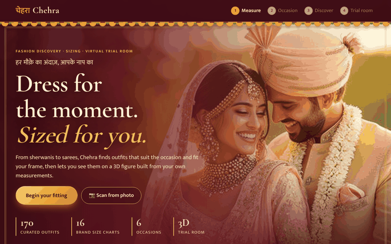
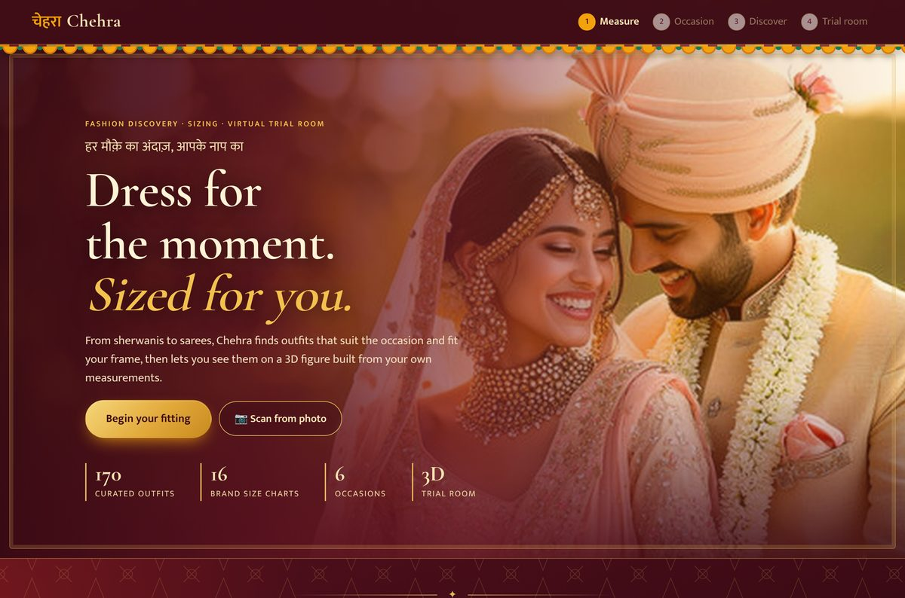
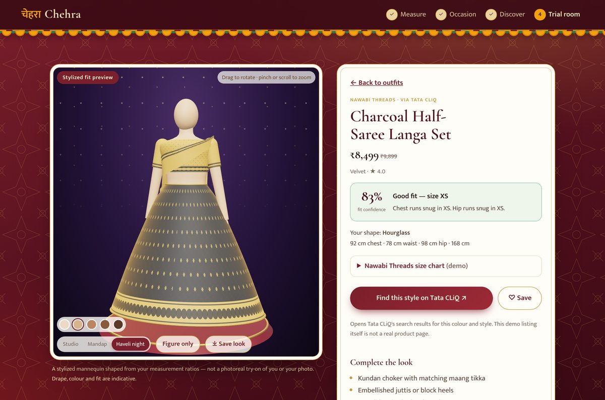
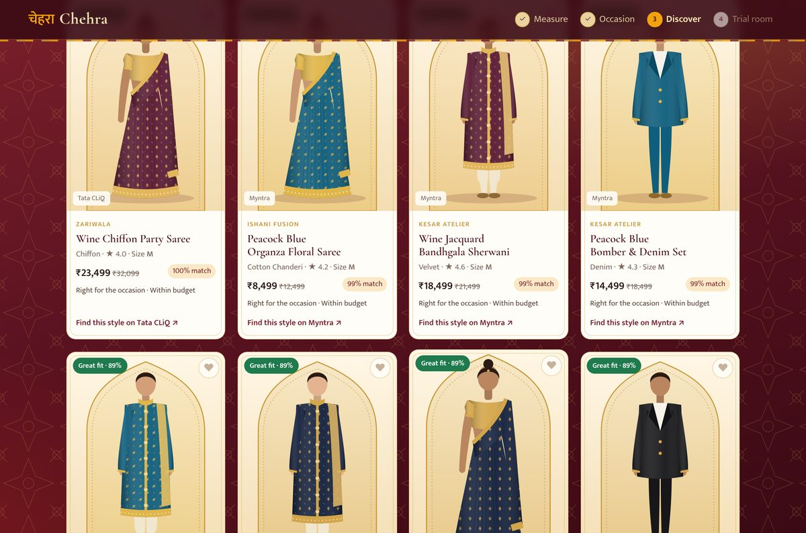

<p align="center">
  
</p>

<p align="center">
  <b>Indian fashion discovery, sizing and a virtual trial room, all in your browser.</b><br />
  <sub>शादी से दफ़्तर तक, हर मौक़े का अंदाज़, आपके नाप का.</sub>
</p>

<p align="center">
  
  
  
  
  
</p>

<p align="center">
  
</p>

<p align="center"></p>

## ✦ What Chehra does

Tell Chehra your measurements and the occasion. It ranks outfits that suit the day, scores how well each brand's sizing fits you, and dresses a 3D figure shaped like you in the one you pick.

| | Step | What happens |
|:-:|---|---|
| 🪡 | **Measure** | Sliders and inputs for height, chest, waist, hip and shoulder width, with an India / US / UK toggle. An optional photo scan estimates them on your device. |
| 🪔 | **Occasion** | Five quick questions: occasion, time of day, formality, budget and the styles you lean towards. |
| 🛍️ | **Discover** | 170 outfits ranked for you, each with a fit-confidence badge from that brand's size chart. Search, filter and save favourites. |
| 👗 | **Trial room** | A stylized Three.js mannequin built from your measurements, wearing the outfit. Drag to rotate, switch backdrops, save the look. |

<p align="center"></p>

## ✦ A closer look

<table>
  <tr>
    <td width="50%"></td>
    <td width="50%"></td>
  </tr>
  <tr>
    <td align="center"><sub><b>Home</b> · festive hero, occasion tiles, measurement form</sub></td>
    <td align="center"><sub><b>Trial room</b> · 3D figure shaped from your measurements</sub></td>
  </tr>
  <tr>
    <td colspan="2"></td>
  </tr>
  <tr>
    <td colspan="2" align="center"><sub><b>Discover</b> · ranked outfits with fit confidence, sources and saved favourites</sub></td>
  </tr>
</table>

<p align="center"></p>

## ✦ Features

- **Sizing that travels**: one set of measurements, shown in centimetres or inches with India, US and UK size labels.
- **Scan from photo**: MediaPipe Pose runs in the browser, uses your height as the scale and pre-fills estimates with a skeleton overlay. Nothing is uploaded.
- **Made for Indian wardrobes**: kurta, sherwani, lehenga and langa, saree, western and fusion, across weddings, festivals and puja, sangeet, office, casual and date night.
- **Fit confidence**: every outfit is matched against its brand's own size chart, with notes on where it runs snug or roomy.
- **3D trial room**: mannequin proportions follow your shoulder, chest, waist, hip and height. Three backdrops, five mannequin tones and a "Save look" image.
- **Little luxuries**: saved outfits, search, a top-pick spotlight and "Complete the look" styling notes.

<p align="center"></p>

## ✦ Honest labels

> [!NOTE]
> **The catalog is a curated demo dataset.** Its 170 listings, brands, prices, ratings and size charts are fictional, and the pictures are generated illustrations. "Source" tags name the kind of store an item would come from, and each outbound link opens that store's search results for the same colour and style rather than a real product page.

> [!NOTE]
> **The trial room is a stylized fit preview**, not a photoreal try-on of you or your photo. Photo-scan measurements are estimates from a single front view, so adjust them before trusting a size.

<p align="center"></p>

## ✦ Run it

```bash
npm install
npm run dev      # local dev server
npm run build    # type-check and build to dist/
```

There is no backend and no sign-in. Saved outfits live in `localStorage`.

## ✦ Under the hood

| Path | Role |
|---|---|
| `src/lib/avatar.ts` | Mannequin and garment geometry |
| `src/lib/pose.ts` | Photo scan and landmark-to-measurement estimates |
| `src/lib/fit.ts`, `src/lib/recommend.ts` | Size matching and ranking |
| `src/lib/productImage.ts` | Generated outfit illustrations |
| `src/data/` | Brands with size charts, catalog generator, store search links |
| `src/components/` | Home, occasion, discover and trial room screens |
| `public/mediapipe/models` | Pose model, served from the app's own origin |

Built with Vite, React, TypeScript, Three.js and `@mediapipe/tasks-vision`. The MediaPipe WASM runtime is copied from `node_modules` into `public/mediapipe/wasm` on install, dev and build.

<p align="center"></p>

<p align="center"><sub>चेहरा · Made for India's festive, formal and everyday wardrobes.</sub></p>
